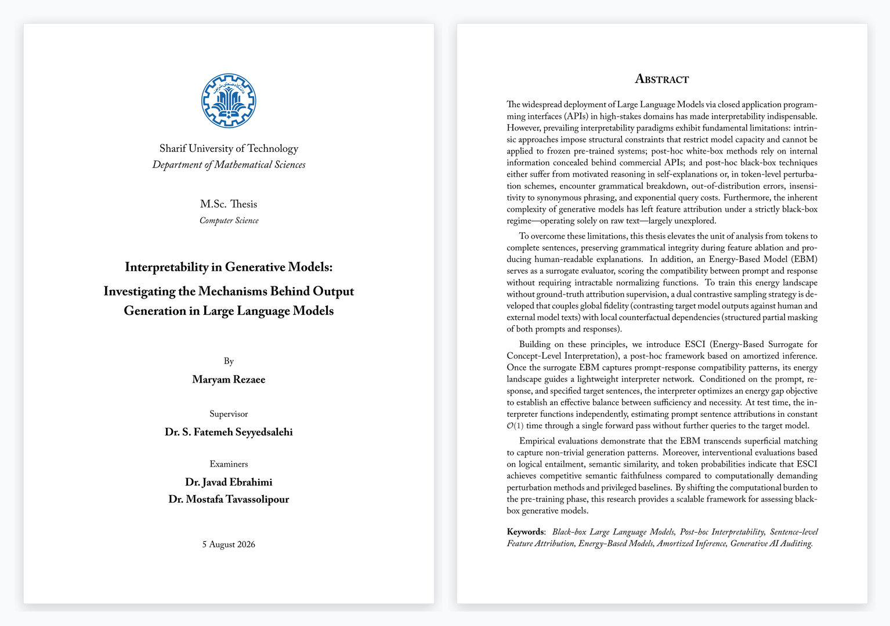
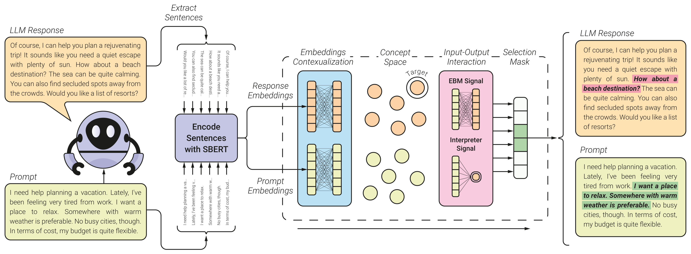
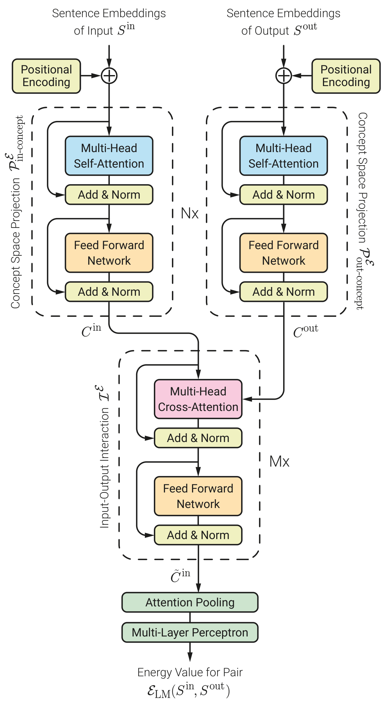
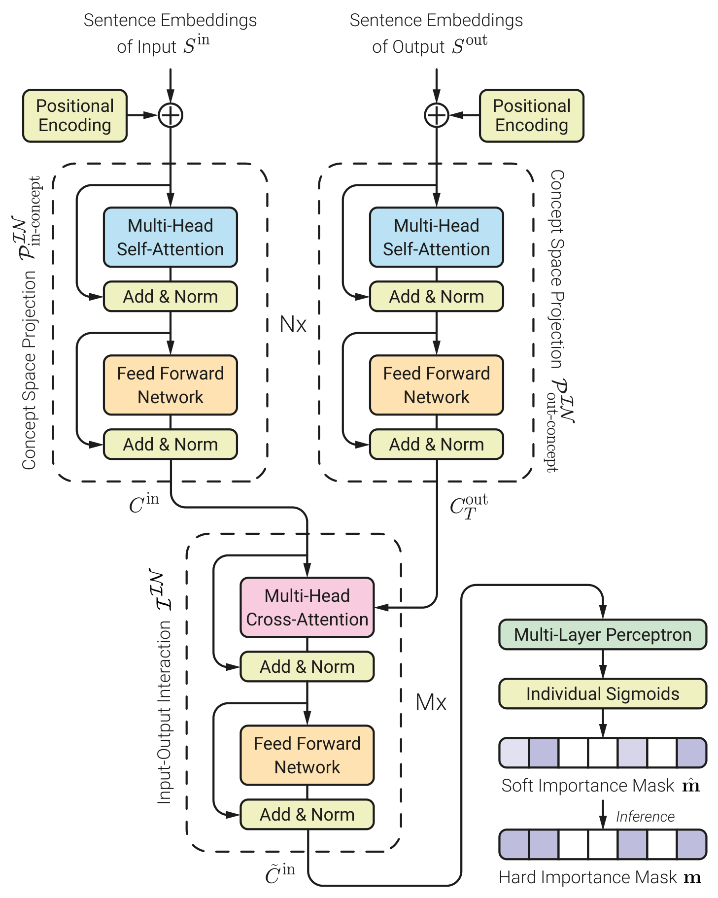
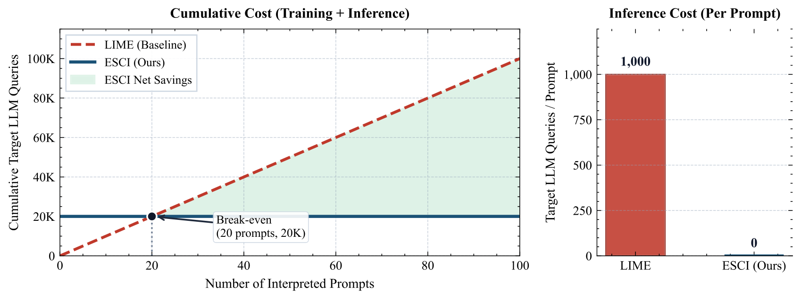

<div align="center">

# Interpretability in Generative Models
### Investigating the Mechanisms Behind Output Generation in Large Language Models

<br/>

**A Master's Thesis in Computer Science**  
**Department of Mathematical Sciences, Sharif University of Technology**  
**[TGML Lab (Trustworthy and Generative Machine Learning Lab)](https://github.com/TGML-Lab)**

<br/>

[](#academic-metadata)
[](#academic-metadata)
[](#compilation--reproduction)
[](https://github.com/TGML-Lab)

<br/>



</div>

---

## Academic Metadata

| Item                  | Details                                                                                                                 |
| :---                  | :---                                                                                                                    |
| **Title**             | *Interpretability in Generative Models: Investigating the Mechanisms Behind Output Generation in Large Language Models* |
| **Persian Title**     | تفسیرپذیری در مدل‌های مولد: بررسی سازوکارهای تولید خروجی در مدل‌های زبانی بزرگ                                      |
| **Author**            | **Maryam Rezaee** ([Website](https://maryamrezaee.me) / [GitHub](https://github.com/msmrexe))                           |
| **Supervisor**        | **Dr. S. Fatemeh Seyyedsalehi** (Department of Mathematical Sciences, Sharif University of Technology)                  |
| **Internal Examiner** | **Dr. Javad Ebrahimi** (Department of Mathematical Sciences, Sharif University of Technology)                           |
| **External Examiner** | **Dr. Mostafa Tavassolipour** (School of Electrical and Computer Engineering, University of Tehran)                     |
| **Degree & Major**    | Master of Science (M.Sc.) in Computer Science                                                                           |
| **Institution**       | Department of Mathematical Sciences, Sharif University of Technology, Tehran, Iran                                      |
| **Research Lab**      | **TGML Lab** ([Trustworthy and Generative Machine Learning Lab](https://github.com/TGML-Lab))                           |
| **Defense Date**      | 5 August 2026 (14 Mordad 1405)                                                                                          |
| **Grade**             | Passed with Excellence (Highest Distinction)                                                                            |

---

## Abstract

The widespread deployment of Large Language Models via closed application programming interfaces (APIs) in high-stakes domains has made interpretability indispensable. However, prevailing interpretability paradigms exhibit fundamental limitations: intrinsic approaches impose structural constraints that restrict model capacity and cannot be applied to frozen pre-trained systems; post-hoc white-box methods rely on internal information concealed behind commercial APIs; and post-hoc black-box techniques either suffer from motivated reasoning in self-explanations or, in token-level perturbation schemes, encounter grammatical breakdown, out-of-distribution errors, insensitivity to synonymous phrasing, and exponential query costs. Furthermore, the inherent complexity of generative models has left feature attribution under a strictly black-box regime—operating solely on raw text—largely unexplored.

To overcome these limitations, this thesis elevates the unit of analysis from tokens to complete sentences, preserving grammatical integrity during feature ablation and producing human-readable explanations. In addition, an Energy-Based Model (EBM) serves as a surrogate evaluator, scoring the compatibility between prompt and response without requiring intractable normalizing functions. To train this energy landscape without ground-truth attribution supervision, a dual contrastive sampling strategy is developed that couples global fidelity (contrasting target model outputs against human and external model texts) with local counterfactual dependencies (structured partial masking of both prompts and responses).

Building on these principles, we introduce **ESCI (Energy-Based Surrogate for Concept-Level Interpretation)**, a post-hoc framework based on amortized inference. Once the surrogate EBM captures prompt-response compatibility patterns, its energy landscape guides a lightweight interpreter network. Conditioned on the prompt, response, and specified target sentences, the interpreter optimizes an energy gap objective to establish an effective balance between sufficiency and necessity. At test time, the interpreter functions independently, estimating prompt sentence attributions in constant $\mathcal{O}(1)$ time through a single forward pass without further queries to the target model.

Empirical evaluations demonstrate that the EBM transcends superficial matching to capture non-trivial generation patterns. Moreover, interventional evaluations based on logical entailment, semantic similarity, and token probabilities indicate that ESCI achieves competitive semantic faithfulness compared to computationally demanding perturbation methods and privileged baselines. By shifting the computational burden to the pre-training phase, this research provides a scalable framework for assessing black-box generative models.

**Keywords:** *Black-box Large Language Models, Post-hoc Interpretability, Sentence-level Feature Attribution, Energy-Based Models, Amortized Inference, Generative AI Auditing.*

---

## Research Motivation & Problem Formulation

### The Black-Box Auditing Dilemma
Modern frontier language models are predominantly deployed as black-box generative mappings:
$$f_\theta: \mathcal{V}^* \to \mathcal{V}^*$$
Operating under zeroth-order query access, an auditor cannot inspect parameter space $\Theta$, activations $\mathbf{h}^{(l)}$, or gradients $\nabla_\theta, \nabla_{\mathbf{x}}$. The auditor can solely submit an input prompt $\mathbf{x}$ and observe the realized discrete text output $\mathbf{y} \sim P_\theta(\cdot \mid \mathbf{x})$, without access to output probability distributions (logits).

<div align="center">

<p><em>Figure 1: High-level architectural pipeline of ESCI. Input prompt and generated response are partitioned into propositional sentence units, projected into a contextualized concept space, and attributed to target output sentences in constant time.</em></p>
</div>

### Why Token-Level Perturbation Fails
Classical black-box attribution algorithms (e.g., standard LIME and SHAP adaptations) perturb subword tokens. In autoregressive language generation, this causes four acute failure modes:
1. **Syntactic and Grammatical Collapse:** Deleting individual tokens destroys grammatical integrity, thrusting inputs into Out-Of-Distribution (OOD) spaces where model drop-offs reflect grammatical dysfunction rather than true semantic reliance.
2. **Lexical Redundancy & Synonym Invariance:** Natural language expresses propositions through multiple synonymous paraphrases; a probability drop on a single token does not imply absence of that underlying concept.
3. **Logit Concealment:** Commercial APIs suppress token logit vectors ($\mathbf{p} \in \Delta^{|\mathcal{V}|-1}$), crippling standard divergence measures.
4. **Exponential Combinatorial Cost:** Auditing prompt subsets over $N$ components incurs $\mathcal{O}(2^N)$ queries over high-latency, pay-per-token network endpoints.

### Propositional Sentence-Level Formulation
Grounded in **Frege's Context Principle** (words only hold meaning in complete propositions) and **Kintsch's Construction-Integration Cognitive Model** (human cognition processes text via networked propositional representations), this thesis elevates the atomic feature unit from tokens to syntactically validated sentences $\mathcal{S} \subset \mathcal{V}^*$:
- **Prompt Sentences:** $\mathbf{x} = (x_1, x_2, \dots, x_N) \in \mathcal{S}^N$
- **Response Sentences:** $\mathbf{y} = (y_1, y_2, \dots, y_M) \in \mathcal{S}^M$
- **Target Output Subset:** $\mathbf{y}\_T = {(y_j)}_{j \in T} \subseteq \mathbf{y}$ where $T \subseteq \{1, \dots, M\}$
- **Attribution Mask:** $\mathbf{m} \in \{0, 1\}^N$, extracting selected antecedent sentences $\mathbf{x}_S = \mathbf{x} \odot \mathbf{m}$

The formal optimization objective seeks the most parsimonious antecedent subset that guarantees output reproduction:
$$\mathbf{m}^* = \arg\min_{\mathbf{m} \in \{0, 1\}^N} \|\mathbf{m}\|\_0 \quad \text{subject to} \quad \mathcal{D}\big(f_\theta(\mathbf{x} \odot \mathbf{m}), \mathbf{y}_T\big) \le \epsilon$$
where $\|\cdot\|_0$ enforces **necessity/sparsity**, and divergence metric $\mathcal{D}$ enforces **sufficiency**.

---

## Methodology: The ESCI Framework

To solve this constrained combinatorial problem without exponential query loops, **ESCI** decouples attribution into two amortized phases:

```
[Raw Black-Box Text] 
         │
         ▼
 ┌─────────────────────────────────────────────────────────────────┐
 │ Phase 1: Surrogate Energy-Based Model (EBM)                     │
 │ • Bidirectional Transformer: E_LM(x, y; θ)                      │
 │ • Unnormalized compatibility function over prompt-response pairs│
 │ • Dual Contrastive Training: Global Fidelity + Local Dependency │
 └────────────────────────────────┬────────────────────────────────┘
                                  │ Guided Compatibility Signals
                                  ▼
 ┌─────────────────────────────────────────────────────────────────┐
 │ Phase 2: Amortized Interpreter Network                          │
 │ • Lightweight conditioning architecture: IN(x, y, T; α)         │
 │ • Optimizes energy gap ΔE(m̂) balanced with L1 sparsity          │
 │ • Single forward-pass O(1) inference: zero test-time API queries│
 └─────────────────────────────────────────────────────────────────┘
```

### Phase 1: Surrogate Energy-Based Compatibility Model ($\mathcal{E}_{\text{LM}}$)
Rather than training a generative surrogate prone to autoregressive hallucination, an unnormalized scalar energy function $\mathcal{E}_{\text{LM}}(\mathbf{x}, \mathbf{y}; \theta)$ is trained to assign low energy values to coherent, mutually compatible prompt-response pairs:

<div align="center">

<p><em>Figure 2: Architectural schematic of the surrogate EBM, scoring sequence compatibility.</em></p>
</div>

The EBM is optimized via an InfoNCE dual-contrastive loss:
$$\mathcal{L}\_{\text{EBM}} = \lambda_{\text{fid}} \mathcal{L}\_{\text{fidelity}} + \lambda_{\text{dep}} \mathcal{L}_{\text{dep}}$$
- **Global Fidelity ($\mathcal{L}_{\text{fidelity}}$):** Contrasts true model generations against negative samples sourced from human responses and foreign language models.
- **Local Counterfactual Dependency ($\mathcal{L}_{\text{dep}}$):** Employs structured sentence-level masking on both prompt and response to enforce fine-grained semantic sensitivity.

### Phase 2: Amortized Interpreter Network ($\mathcal{IN}$)
Once trained, the EBM landscape guides a dedicated interpreter network $\mathcal{IN}(\mathbf{x}, \mathbf{y}, T; \alpha)$. The interpreter computes continuous selection probabilities $\hat{\mathbf{m}} = \sigma(\mathbf{z}) \in [0, 1]^N$ conditioned on prompt $\mathbf{x}$, response $\mathbf{y}$, and target indices $T$:

<div align="center">

<p><em>Figure 3: Interpreter network architecture with cross-attention target conditioning and Sigmoid Bernoulli parameterization.</em></p>
</div>

The interpreter is trained by maximizing the **energy gap** between masked and unmasked prompts, penalized by an $L_1$ sparsity regularizer:
$$\mathcal{L}\_{\text{interpreter}}(\alpha) = -\mathbb{E}\left[ \mathcal{E}\_{\text{LM}}\big(\mathbf{x} \odot (\mathbf{1} - \hat{\mathbf{m}}), \mathbf{y}\_T; \theta\big) - \mathcal{E}\_{\text{LM}}\big(\mathbf{x} \odot \hat{\mathbf{m}}, \mathbf{y}\_T; \theta\big) \right] + \lambda_{\text{sparse}} \|\hat{\mathbf{m}}\|_1$$

At inference time, attribution is produced in **constant $\mathcal{O}(1)$ time** with a single forward pass through $\mathcal{IN}$—requiring **zero additional queries** to the target black-box LLM.

---

## Experimental Validation & Results

The framework was evaluated across heterogeneous model architectures, task environments, and baseline tiers:
- **Target LLMs:** Meta Llama-3.1-8B-Instruct (GQA architecture), Google Gemma-2-9B-It (alternating local/global attention + GeGLU), and OpenAI GPT-4o-Mini (proprietary commercial black-box).
- **Datasets:** **HC3** (multi-domain open conversational Q&A) and **WikiBio** (structured data-to-text with deterministic factual anchors).
- **Baseline Spectrum:**
  - *Black-Box:* Linguistic Oracle Committee, Model Self-Explanation, LIME-BlackBox (sentence-level), StringMatching heuristic, and Dirichlet Random baseline.
  - *Gray-Box & White-Box:* Transformer Raw Attention, Attention Rollout, Gradient $\times$ Input, Grad-SHAP, Sentence Leave-One-Out (Sentence-LOO), and LIME-GrayBox.

### 1. Interventional Faithfulness Evaluation
Faithfulness was assessed using a tripartite interventional protocol measuring **Sufficiency** ($\mathcal{S}$), **Comprehensiveness** ($\mathcal{C}$), and the net **Faithfulness Gap** ($\Delta\mathcal{F} = \mathcal{S} - \mathcal{C}$) across three metrics: Natural Language Inference entailment ($\mathcal{F}\_{\text{NLI}}$), maximum cosine sentence similarity ($\mathcal{F}\_{\text{cosine}}$), and normalized token log-probabilities ($\mathcal{F}_{\text{logprob}}$):

| Target Model | Method | Access Level | Faithfulness Gap ($\Delta\mathcal{F}_{\text{NLI}}$) $\uparrow$ | Sufficiency ($\mathcal{S}_{\text{NLI}}$) $\uparrow$ | Comprehensiveness ($\mathcal{C}_{\text{NLI}}$) $\downarrow$ |
| :--- | :--- | :---: | :---: | :---: | :---: |
| **Llama-3.1-8B** | Dirichlet Random | Black-Box | $-0.244$ | $0.210$ | $0.454$ |
| | Self-Explanation | Black-Box | $+0.066$ | $0.518$ | $0.452$ |
| | Raw Attention | White-Box | $+0.093$ | $0.577$ | $0.484$ |
| | Input $\times$ Gradient | White-Box | $-0.027$ | $0.491$ | $0.518$ |
| | **ESCI (Ours)** | **Strict Black-Box** | $\mathbf{+0.108} \pm 0.004$ | $\mathbf{0.589}$ | $\mathbf{0.481}$ |
| | Sentence-LOO | Privileged | $+0.123$ | $0.604$ | $0.481$ |
| **Gemma-2-9B** | Dirichlet Random | Black-Box | $-0.283$ | $0.241$ | $0.524$ |
| | Self-Explanation | Black-Box | $+0.143$ | $0.602$ | $0.459$ |
| | Raw Attention | White-Box | $+0.084$ | $0.581$ | $0.497$ |
| | Input $\times$ Gradient | White-Box | $+0.029$ | $0.536$ | $0.507$ |
| | **ESCI (Ours)** | **Strict Black-Box** | $\mathbf{+0.228} \pm 0.004$ | $\mathbf{0.675}$ | $\mathbf{0.447}$ |
| | Sentence-LOO | Privileged | $+0.295$ | $0.721$ | $0.426$ |

> **Key Finding:** In semantic NLI faithfulness ($\Delta\mathcal{F}_{\text{NLI}}$), ESCI outperforms internal gradient and attention baselines despite having no access to internal weights, and closely approaches computationally intensive combinatorial search methods.

### 2. Computational Scalability & Break-Even Analysis

<div align="center">

<p><em>Figure 5: Total API queries as a function of audited prompts. ESCI breaks even with perturbation-based methods (e.g., LIME) after auditing only ~20 prompts, incurring zero marginal query cost thereafter.</em></p>
</div>

- **Perturbation Complexity:** A typical LIME audit of an average $N=10$ sentence prompt requires $K \approx 1{,}000$ API queries per instance ($\mathcal{O}(P \cdot K)$ total queries for $P$ instances).
- **Amortized ESCI Efficiency:** ESCI pretrains the surrogate landscape on $D_{\text{train}} \approx 20{,}000$ offline samples once. The break-even point is reached at:
  $$P_{\text{break-even}} = \frac{D_{\text{train}}}{K_{\text{LIME}}} = \frac{20{,}000}{1{,}000} = 20 \text{ prompts}$$
- After auditing just 20 prompts, ESCI's test-time marginal API query cost is **strictly zero**.

---

## Repository Structure

```
MaryamRezaee-MScThesis/
├── thesis.tex                     # Master LaTeX entry point
├── thesis.pdf                     # Final pdf output
├── latexmkrc                      # Build recipe with automated dictionary hooks
├── CITATION.cff                   # Machine-readable Citation File Format metadata
├── README.md                      # Comprehensive academic documentation
│
├── chapters/                      # Main body thesis chapters
│   ├── chapter1_introduction.tex  # Problem definition, research questions & contributions
│   ├── chapter2_preliminaries.tex # Theoretical foundations: LLMs, EBMs & contrastive loss
│   ├── chapter3_literature.tex    # Literature review: intrinsic, white-box & black-box XAI
│   ├── chapter4_methodology.tex   # Formal formulation of the ESCI framework
│   ├── chapter5_experiments.tex   # Experimental setup, empirical benchmarks & results
│   └── chapter6_conclusions.tex   # Summary of findings, limitations & future horizons
│
├── frontmatter/                   # Preliminary thesis pages (Persian)
│   ├── info.tex                   # [CENTRAL CONFIG] Metadata: title, author, committee
│   ├── title.tex                  # Persian title page
│   ├── abstract.tex               # Persian abstract & keywords
│   ├── signatures.tex             # Examination committee approval page
│   ├── declaration.tex            # Academic integrity declaration
│   ├── acknowledgments.tex        # Acknowledgments / سپاسگزاری
│   └── images/                    # Sharif University of Technology official logo
│
├── backmatter/                    # Back matter and English documentation
│   ├── title_en.tex               # English title page
│   ├── abstract_en.tex            # English abstract & keywords
│   ├── words.tex                  # Single source of truth for technical bilingual glossary
│   ├── dictionary_fa2en.tex       # Persian-to-English dictionary display wrapper
│   ├── dictionary_en2fa.tex       # English-to-Persian dictionary display wrapper
│   └── dict_*_content.tex         # Auto-generated collated dictionary files
│
├── appendices/                    # Supplementary materials and extended derivations
│   ├── appendix.tex               # Appendix loader
│   ├── appendix_hyperparams.tex   # Hyperparameter grids for EBM and Interpreter training
│   ├── appendix_negative_samplers.tex  # Ablation of contrastive sampling strategies
│   ├── appendix_softmax_bottleneck.tex # Theoretical analysis of softmax bottleneck in attention
│   └── appendix_lime_adaptation.tex    # Formal adaptation of LIME to sentence-level text
│
├── bibliography/                  # Reference database & custom bibliography styles
│   ├── bibliography.tex           # Bibliography loader
│   ├── refs.bib                   # Primary BibTeX bibliography database
│   ├── full.bib                   # CS conference & journal abbreviation definitions
│   └── unsrtabbrv.bst             # Hyperlinked BibTeX style with clickable DOIs/URLs
│
├── figures/                       # Vector graphics, architecture diagrams, and PNG assets
│   ├── thesis_overview_snapshot.png                # Composite image of English title & abstract pages
│   ├── Fig-Framework-Overview-V5.png               # Full ESCI framework architecture
│   ├── Fig-EBM-Architecture-V4.png                 # EBM compatibility surrogate network
│   ├── Fig-Interpreter-Architecture-V4.png         # Interpreter network architecture
│   ├── Fig-INTERP-Computational-Scalability-V3.png # Scalability break-even curve
│   └── *.pdf                                       # Vector publication figures
│
├── styles/                        # Typesetting engine and font definitions
│   ├── common.tex                 # Core LaTeX packages, XePersian configuration & geometry
│   ├── custom.tex                 # Custom math operators, theorem styles & callout boxes
│   └── fonts/                     # Bundled TrueType fonts (XB Niloofar, Adobe Caslon Pro)
│
└── scripts/                       # Automation pipelines
    ├── build_dictionaries.py      # Automated Unicode Persian/English dictionary compiler
    ├── export_front_pages.py      # Standalone single-page PDF generator for official forms
    └── export_front_pages.ps1     # PowerShell wrapper for export_front_pages.py
```

---

## Compilation

### Prerequisites
- **TeX Distribution:** TeX Live 2022+ or MiKTeX 22.0+ with **XeLaTeX** and `latexmk`.
- **Fonts:** All required OpenType and TrueType fonts (`XB Niloofar`, `Adobe Caslon Pro`, and `Sharif Font`) are bundled in `styles/fonts/` and loaded automatically by path without requiring system-wide installation.
- **Python:** Python 3.8+ (for automated glossary collation in `scripts/build_dictionaries.py`).

### Option A: VS Code with LaTeX Workshop (Recommended)
1. Open this repository folder in VS Code.
2. Ensure the [LaTeX Workshop](https://marketplace.visualstudio.com/items?itemName=James-Yu.latex-workshop) extension is installed.
3. Open `thesis.tex` and trigger the pre-configured recipe: `latexmk (xelatex)`.
4. Compilation settings and `chktex` linting exceptions are pre-configured in `.vscode/settings.json`.

### Option B: Command-Line Interface (`latexmk`)
Execute `latexmk` with XeLaTeX engine targeting:
```bash
latexmk -xelatex -synctex=1 -interaction=nonstopmode thesis.tex
```

To clean intermediate auxiliary build artifacts (`.aux`, `.log`, `.fls`, `.bbl`, etc.):
```bash
latexmk -c thesis.tex
```

To regenerate the bidirectional technical dictionaries:
```bash
python scripts/build_dictionaries.py
```

---

## Citation

If you use this research methodology or the literature review in your work, please cite it as follows:

```bibtex
@mastersthesis{rezaee2026interpretability,
  author       = {Maryam Rezaee},
  title        = {Interpretability in Generative Models: Investigating the Mechanisms Behind Output Generation in Large Language Models},
  school       = {Department of Mathematical Sciences, Sharif University of Technology},
  year         = {2026},
  month        = {August},
  type         = {Master's Thesis},
  address      = {Tehran, Iran},
  note         = {Supervised by Dr. S. Fatemeh Seyyedsalehi. TGML Lab},
  url          = {https://github.com/TGML-Lab/MaryamRezaee-MScThesis}
}
```

This repository also includes a machine-readable [CITATION.cff](CITATION.cff) file adhering to Citation File Format 1.2.0, enabling direct citation export via GitHub's **"Cite this repository"** interface.

---

<div align="center">
  <sub>Research conducted at <b><a href="https://github.com/TGML-Lab">TGML Lab (Trustworthy and Generative Machine Learning Lab)</a></b>, Department of Mathematical Sciences, Sharif University of Technology.</sub>
</div>
